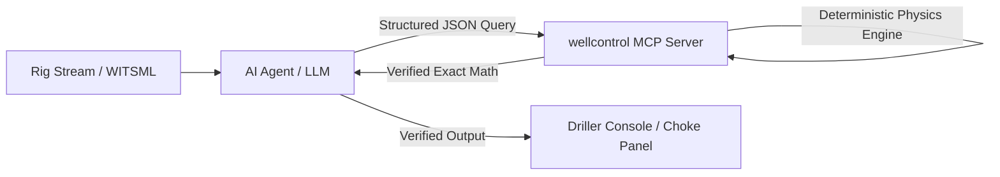

Large Language Models (LLMs) are exceptional at synthesizing drilling logs, interpreting standard operating procedures (SOPs), and reasoning through complex operational triage.

However, in safety-critical operations—where bottomhole circulating pressures exceed $10,000\text{ psi}$ and kicking gas migrates at hundreds of feet per hour—**an LLM must never be permitted to generate pressure values or kill mud calculations via token prediction.**

Token generation is probabilistic. Well control physics must be deterministic.

If an autonomous rig agent hallucinates an Initial Circulating Pressure by just $80\text{ psi}$, it can collapse the casing or fracture the formation, escalating an ordinary kick into a surface blowout.

---

## 1. The Architectural Solution: Model Context Protocol (MCP)

To harness the cognitive and reasoning capabilities of AI agents without risking physical hallucinations, we pair agentic reasoning frameworks with deterministic engineering engines via the **Model Context Protocol (MCP)**.



### How the Layered Responsibility Works:
1. **The LLM's Role (Reasoning & Orchestration):**
   - Continuously monitors WITSML telemetry events (SPP spikes, pit gains, differential pressure changes).
   - Identifies kick mechanisms, lost circulation anomalies, or drillstring pack-offs.
   - Formulates the action plan in accordance with rig-specific SOPs.
2. **The MCP Tool's Role (Deterministic Math & Physics):**
   - Computes exact hydrostatics, friction losses, multi-station torque and drag, and kill schedules.
   - Operates with zero external network access and zero token randomness.
   - Verified across hundreds of automated unit tests covering API RP 53, IADC, and IWCF benchmarks.

---

## 2. Real-World Implementation: The `wellcontrol` MCP Server

Our [`wellcontrol`](https://github.com/Greybeard00007/wellcontrol) repository implements an production-grade MCP server exposing 5 core operational tools:

### Exposed MCP Tools:
* **`evaluate_kill_methods`**: Compares Wait & Weight, Driller's Method, Volumetric, and Bullheading against current hole volume, casing burst rating, and maximum surface pressure limits.
* **`plan_well_kill`**: Generates step-by-step stroke schedules, initial and final circulating pressures, and casing shoe loading traces.
* **`plan_stripping_and_snubbing`**: Computes pipe-light / pipe-heavy transition points, buoyant string weight, and annular choke bleeding schedules for tripping under pressure.
* **`simulator_list_scenarios`** & **`simulator_create_or_step`**: Connects directly to the transient 7-screen choke simulator for real-time training evaluation.

```python
# Example MCP Tool Definition in wellcontrol
@mcp.tool()
async def plan_well_kill(
    method: str,
    depth_tvd_ft: float,
    current_mw_ppg: float,
    sidpp_psi: float,
    sicp_psi: float,
    scrp_psi: float,
    drillstring_vol_bbl: float,
    pump_output_bbl_stk: float
) -> dict[str, Any]:
    """Calculates deterministic IADC WellSharp kill parameters.
    No LLM prediction: strictly verified deterministic formulas."""
    
    # 1. Kill Mud Weight with directional ceiling
    raw_kmw = current_mw_ppg + sidpp_psi / (0.052 * depth_tvd_ft)
    kmw = math.ceil((raw_kmw - 1e-9) * 10) / 10
    
    # 2. ICP & FCP
    icp = round(sidpp_psi + scrp_psi)
    fcp = math.ceil((scrp_psi * kmw / current_mw_ppg) - 1e-9)
    
    # 3. Surface-to-bit displacement strokes
    strokes_to_bit = round(drillstring_vol_bbl / pump_output_bbl_stk)
    
    return {
        "method": method,
        "kmw_ppg": kmw,
        "icp_psi": icp,
        "fcp_psi": fcp,
        "strokes_to_bit": strokes_to_bit,
        "pressure_drop_per_100_stk": math.floor(((icp - fcp) * 100 / strokes_to_bit) + 1e-9)
    }
```

---

## 3. CI/CD Governance & RAG Evaluation Gates

Even when tools provide exact mathematical answers, agents must synthesize them into coherent action checklists for the toolpusher or driller.

To prevent prompt drift or hallucinated section citations, we introduced **`sop-rag-judge`**:
* Evaluates generated action plans against ground-truth SOP documents before outputs leave the edge server.
* Checks **numeric drift**: If the agent's summary mentions a pressure differing by even $\pm 1\text{ psi}$ from the MCP tool output, the gate rejects the response.
* Runs automated hallucination and citation verifications across continuous integration test suites.

---

## Summary

Combining generative reasoning with deterministic tool execution is the foundational requirement for AI in high-hazard environments. By using MCP as the abstraction boundary between language models and physical formulas, we achieve the best of both worlds: autonomous operational insight with deterministic physical safety.

You can explore the live simulator at [**wellcontrol.kcklayton.com**](https://wellcontrol.kcklayton.com) or inspect the MCP implementation on GitHub:
👉 [**github.com/Greybeard00007/wellcontrol**](https://github.com/Greybeard00007/wellcontrol)
