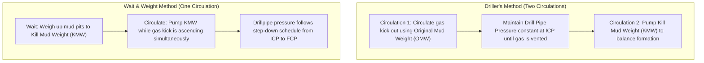

When taking a kick while drilling, one of the most dangerous assumptions an engineer or driller can make is treating an influx of natural gas as an incompressible fluid or assuming ideal gas behavior.

Natural gas (primarily methane, $\text{CH}_4$) under high downhole pressures ($5,000\text{ to }15,000\text{ psi}$) and high temperatures ($150^\circ\text{F to }350^\circ\text{F}$) behaves as a dense supercritical fluid. Its volume changes very little as it ascends from $15,000\text{ ft}$ to $5,000\text{ ft}$. However, as it approaches the surface, **expansion accelerates exponentially**.

In this article, we examine the physics of non-ideal gas expansion, casing shoe pressure dynamics during circulation, and how our multiphase numerical engine in [**WellSim**](https://wellsim.kcklayton.com) solves these equations in real time.

---

## 1. The Real Gas Law & The Critical $Z$-Factor

The volume of a gas kick at any depth in the wellbore is governed by the non-ideal Real Gas Law:

$$P V = Z n R T \quad \implies \quad V(P, T) = \frac{Z(P, T) n R T}{P}$$

Where:
* $P$ = Absolute downhole pressure ($\text{psi}$)
* $V$ = Influx volume ($\text{bbl}$ or $\text{ft}^3$)
* $Z$ = Compressibility factor (dimensionless deviation from ideal gas)
* $n$ = Moles of gas
* $R$ = Universal gas constant
* $T$ = Absolute temperature ($^\circ\text{R}$)

```
         Gas Volume Expansion vs. Depth Profile
Depth (ft)
   0 |------------------------------------------> [Violent Expansion: 50+ bbl]
     |                                      /
2,000|                                     /
     |                                   /
4,000|                                  /
     |                                /
6,000|                               |
     |                              |
8,000|                             |
     |                             |  [Dense Supercritical Phase: ~10 bbl]
10,000|                             |
     +------------------------------------------->
     0                             20            40            60
                            Annular Volume (bbl)
```

At deep reservoir conditions ($P > 6,000\text{ psi}$), molecular repulsive forces dominate, making the gas less compressible ($Z > 1.0$). As the gas migrates toward the surface, $P$ drops. At intermediate pressures ($1,500 - 3,000\text{ psi}$), attractive intermolecular forces peak ($Z$ drops as low as $0.65 - 0.75$).

Once the bubble crosses above the $2,000\text{ ft}$ threshold, pressure drops below $1,000\text{ psi}$, and the term $\frac{1}{P}$ explodes. A $10\text{ bbl}$ bottomhole kick can expand into **over $80\text{ to }120\text{ bbl}$ of gas** by the time it reaches the surface BOP choke line.

---

## 2. Casing Shoe Pressure Dynamics: Peak Fracture Risk

During a well kill, the primary objective is to maintain bottomhole pressure ($P_{\text{BHP}}$) slightly above formation pore pressure while never exceeding the fracture breakdown pressure of the weakest exposed rock—almost always at the **last casing shoe depth** ($D_{\text{shoe}}$).

### When Does Casing Shoe Pressure Peak?
In a typical vertical or deviated well, casing shoe pressure $P_{\text{shoe}}$ does **not** peak at shut-in, nor when gas reaches the surface. **Shoe pressure reaches its absolute maximum when the top of the gas influx arrives directly at the casing shoe depth.**

$$\begin{aligned}
P_{\text{shoe}}(t) &= P_{\text{surface\_casing}}(t) + \int_{0}^{D_{\text{shoe}}} \rho_{\text{ann}}(z, t) \, g \, dz \\
&= P_{\text{BHP}} - \int_{D_{\text{shoe}}}^{D_{\text{total}}} \rho_{\text{ann}}(z, t) \, g \, dz
\end{aligned}$$

As the gas column transitions from below the shoe to above the shoe:
1. Below the shoe: Low-density gas replaces heavy drilling mud in the open hole. To keep bottomhole pressure constant, surface casing choke pressure must rise, increasing pressure against the shoe.
2. Once the gas enters the cased hole above the shoe: Heavy mud remains below the shoe in the open hole, stabilizing or decreasing the net stress against the exposed formation.

---

## 3. Driller's Method vs. Wait & Weight: Dynamic Comparison

The two standard IADC constant bottomhole pressure methods differ significantly in casing shoe stress and operational complexity:



### Comparison Matrix:

| Operational Metric | Driller's Method | Wait & Weight (Engineer's) | Operational Impact |
| :--- | :--- | :--- | :--- |
| **Reaction Time** | **Immediate** | Delayed (must mix mud) | Driller's method prevents gas migration during shut-in |
| **Max Casing Shoe Pressure** | **Higher** | **Lower (by $100 - 400\text{ psi}$)** | W&W introduces heavy mud into drillstring and annulus earlier |
| **Max Surface Choke Pressure** | High | Moderately Lower | W&W reduces surface equipment stress |
| **Calculation Complexity** | Low (Hold SIDPP/ICP) | High (Requires exact stroke step-down chart) | Higher probability of human error on the choke console |
| **Total Circulation Time** | $\approx 2 \times$ Annular Volume | $\approx 1.2 \times$ Annular Volume | W&W clears well faster once pumping starts |

---

## 4. How WellSim Solves the Multiphase Drift-Flux Equations

In [WellSim](https://wellsim.kcklayton.com), the wellbore is discretized into $N$ spatial cells along the measured depth $s$. For each cell $i$, the engine tracks mass conservation of the liquid mud phase and free gas phase:

$$\frac{\partial}{\partial t} \left( \alpha_g \rho_g \right) + \frac{\partial}{\partial s} \left( \alpha_g \rho_g v_g \right) = \Gamma_g$$

$$\frac{\partial}{\partial t} \left( \alpha_l \rho_l \right) + \frac{\partial}{\partial s} \left( \alpha_l \rho_l v_l \right) = -\Gamma_g$$

Where $\alpha_g$ is gas holdup ($0 \le \alpha_g \le 1$), $\rho$ is phase density, and the gas slip velocity $v_g$ relative to liquid velocity $v_l$ is governed by the **Zuber-Findlay drift-flux relation**:

$$v_g = C_0 v_m + v_d$$

Where:
* $C_0$ is the profile distribution parameter ($\approx 1.2$ for turbulent pipe/annular flow)
* $v_m = \alpha_g v_g + \alpha_l v_l$ is the mixture superficial velocity
* $v_d$ is the buoyant slip velocity of gas bubbles through viscous non-Newtonian drilling fluid:

$$v_d = 1.53 \left[ \frac{\sigma \, g \, (\rho_l - \rho_g)}{\rho_l^2} \right]^{0.25}$$

```python
# Core drift-flux gas velocity calculation from WellSim physics kernel
import math

def calculate_gas_slip_velocity(
    rho_liquid_ppg: float,
    rho_gas_ppg: float,
    v_mixture_fps: float,
    surface_tension_dyne_cm: float = 25.0,
    c0: float = 1.2
) -> float:
    """
    Computes slip velocity of gas influx in drilling fluid using Zuber-Findlay drift-flux formulation.
    """
    # Unit conversions to SI (kg/m^3, m/s)
    rho_l = rho_liquid_ppg * 119.826
    rho_g = rho_gas_ppg * 119.826
    sigma = surface_tension_dyne_cm * 1e-3
    g = 9.80665

    # Buoyancy drift component (Harmathy / Zuber-Findlay)
    v_drift = 1.53 * math.pow((sigma * g * (rho_l - rho_g)) / (rho_l ** 2), 0.25)
    v_drift_fps = v_drift * 3.28084

    # Combined slip velocity
    v_gas_fps = c0 * v_mixture_fps + v_drift_fps
    return v_gas_fps
```

---

## 5. Practical Takeaways for Well Engineers

1. **Never Choke on Gas Volume; Choke on Drillpipe Pressure:** While circulating gas to surface, casing pressure will wildly fluctuate as gas expands. **Do not try to keep casing pressure steady.** Keep drillpipe circulating pressure locked on the kill schedule; let the casing choke fluctuate to accommodate gas expansion.
2. **Watch the Shoe Window:** If your LOT (Leak-Off Test) margin is narrow ($< 0.5\text{ ppg}$ equivalent), calculating peak shoe pressure with non-ideal $Z$-factor dynamics is vital. If predicted shoe pressure exceeds fracture limit, the engineer must immediately select the Wait & Weight method or reduce pump rate to lower annular friction.
3. **Simulate Before Circulating:** Real-time dynamic simulators like [WellSim](https://wellsim.kcklayton.com) provide drillers and rig superintendents with second-by-second predictive pressure plots before initiating the pumps.
